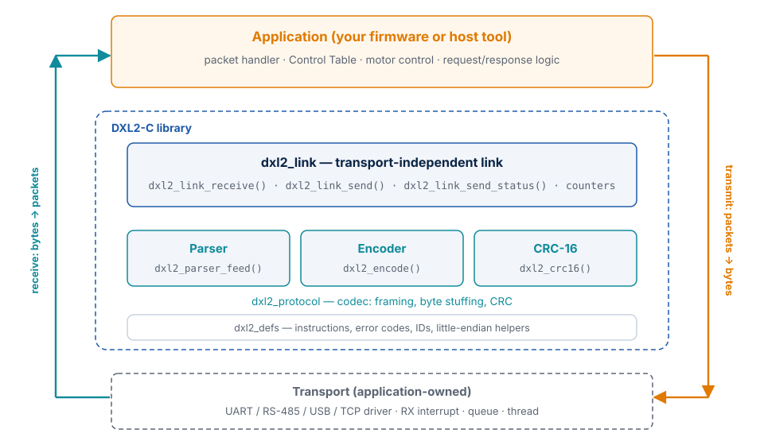
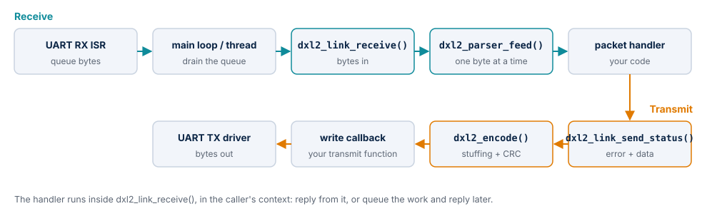
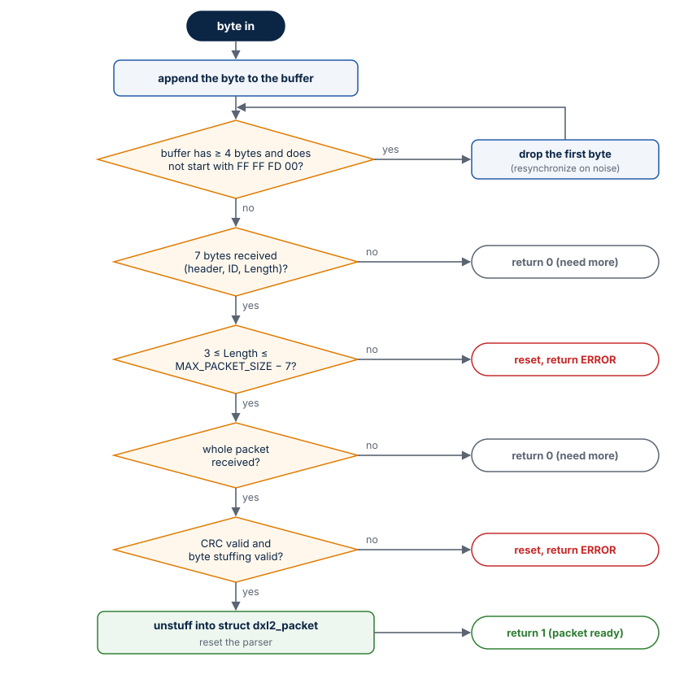

# How It Works

This chapter explains the internal structure of DXL2-C: its layers, how a byte becomes a
packet and a packet becomes bytes, how the parser recovers from errors, and the rules for
memory, errors and concurrency that follow from the design.

## Layers

The library has three layers. Each one depends only on the layers below it.

| Layer | Header | Responsibility |
| --- | --- | --- |
| Definitions | `dxl2_defs.h` | Instruction and error values from the specification, broadcast ID, little-endian helpers. No state, no functions with side effects. |
| Codec | `dxl2_protocol.h` | CRC-16, the incremental stream parser and the encoder. Pure functions over caller-owned buffers. |
| Link | `dxl2_link.h` | Glue between the codec and a transport: owns a parser, dispatches packets to a handler, sends packets through a write function, counts good and bad packets. |

`dxl2.h` includes all of them, together with the build-time configuration in
`dxl2_config.h`. Applications normally include only `dxl2.h`.

You can use the codec without the link — for example in a tool that parses a log file, or
in firmware that already has its own message dispatcher. The link is a thin convenience
layer (about 100 lines) on top of the codec.

## Data flow

**Receive path.** Your transport delivers bytes — typically a UART interrupt puts them in
a queue, and a main loop or thread takes them out. You pass them to
`dxl2_link_receive()` in chunks of any size. The link feeds them one at a time to
`dxl2_parser_feed()`. Whenever the parser completes a valid packet, the link increments
its `rx_packets` counter and calls your packet handler with a pointer to the decoded
packet. Rejected packets increment `invalid_packets` and are otherwise ignored.

**Transmit path.** To send, you call `dxl2_link_send()` (any instruction) or
`dxl2_link_send_status()` (a Status Packet). The link encodes the packet into a buffer on
its own stack with `dxl2_encode()`, which adds the header, Length, byte stuffing and CRC,
and then passes the complete packet to your write function in one call.

The handler runs inside `dxl2_link_receive()`, in the context that called it. It may send
replies on the same link directly: transmitting does not touch the parser.

## The parser

`dxl2_parser_feed()` consumes exactly one byte per call and returns `1` (packet ready),
`0` (need more bytes) or `DXL2_PARSE_ERROR`. Internally it keeps the bytes of the packet
in progress in `struct dxl2_parser`:

1. **Append.** The new byte is stored at the end of the buffer.
2. **Synchronize.** While the buffer holds at least four bytes that are not the header
   `FF FF FD 00`, the first byte is dropped. This sliding window discards noise and
   partial packets and lines the buffer up with the next header.
3. **Check the Length.** Once seven bytes are present (header, ID, Length), the Length
   field is checked: it must be at least 3 (instruction and CRC) and the whole packet must
   fit in `DXL2_MAX_PACKET_SIZE`. A bad Length is rejected at once, without waiting for
   bytes that may never come.
4. **Wait.** Until `7 + Length` bytes are present, the parser returns `0`.
5. **Validate and decode.** The CRC is checked over the stuffed bytes, exactly as they
   were sent. Then byte stuffing is removed while the instruction and parameters are
   copied into `struct dxl2_packet`. A header sequence without its stuffing byte is a
   malformed packet.
6. **Reset.** After a packet — valid or not — the parser buffer is emptied and the next
   byte starts a new search.

The cost per byte is constant except for the synchronization step, which moves at most
`DXL2_MAX_PACKET_SIZE` bytes. There is no recursion and no data-dependent loop without a
fixed bound, so the worst-case execution time is easy to bound.

!!! note "Recovery after errors"
    The bytes of a rejected packet are discarded. If a lost byte makes the Length field
    reach into the next packet, that packet is rejected too, and the parser locks onto the
    one after it. Controllers should treat a missing reply as a timeout and retry.

## The encoder

`dxl2_encode()` writes the header and ID, then copies the instruction and parameters into
the output buffer. After every byte it checks whether the last three bytes written are
`FF FF FD`; if so, it inserts an extra `FD`. It then fills in the Length field — which
counts the stuffed bytes — and appends the CRC computed over everything before it.

The output capacity is checked before every byte is written, so an undersized buffer
returns `DXL2_PARSE_ERROR` instead of overflowing. The worst case for stuffing is one
extra byte per three parameter bytes; with `DXL2_MAX_PACKET_SIZE` as the capacity, every
packet that the parser accepts can also be encoded.

## Memory model

All state lives in two structures that you allocate — statically, on a stack or inside
your own objects:

| Structure | Contents | Size with the default configuration |
| --- | --- | --- |
| `struct dxl2_parser` | bytes of the packet in progress, their count | 256 bytes + `size_t` |
| `struct dxl2_packet` | ID, instruction, parameter count, unstuffed parameters | 250 bytes |
| `struct dxl2_link` | configuration, one parser, the last packet, two counters | ≈ 550 bytes on a 32-bit MCU |

The library has no global variables except one read-only table (the header bytes), never
calls `malloc()`, and allocates only fixed-size buffers on the stack: one packet buffer in
`dxl2_link_send()` and one parameter buffer in `dxl2_link_send_status()`. The measured
stack usage per function is listed in [Configuration](configuration.md#stack-usage).

Because nothing is shared, you can have as many links as you have buses, each with its
own configuration.

## Error handling

Every function reports errors through its return value; nothing is printed, logged or
asserted.

| Situation | Result |
| --- | --- |
| A `NULL` pointer or inconsistent length passed to a function | `DXL2_PARSE_ERROR` (or `0` for `dxl2_crc16()` and the counters); nothing is written |
| A packet with a bad Length, CRC or byte stuffing | `dxl2_parser_feed()` returns `DXL2_PARSE_ERROR`; the link counts it in `invalid_packets` |
| A packet that does not fit in the output buffer | `dxl2_encode()` and `dxl2_link_send*()` return `DXL2_PARSE_ERROR` |
| The write function fails | `dxl2_link_send*()` return the write function's own (negative) value |
| A corrupted parser structure (for example, never initialized) | `dxl2_parser_feed()` resets it and returns `DXL2_PARSE_ERROR` instead of writing out of bounds |

Protocol-level errors that a *device* reports — an unknown instruction, an address out of
range — are not library errors. Your handler sends them back as the error byte of a
Status Packet (`DXL2_ERR_*`).

## Threading and reentrancy

The library contains no locks, by design: the right primitive depends on your system, and
a hidden mutex would make the library unusable in interrupt-only firmware.

- **Codec functions** are reentrant. They only touch the buffers you pass in, so they can
  be called from any context, concurrently, as long as each call has its own buffers.
- **A link** is not thread-safe. Call `dxl2_link_receive()` for a given link from one
  context only. Do not call it from an interrupt handler: the packet handler runs inside
  it and usually transmits.
- **Sending** from several contexts at once (for example an RX thread replying and an
  application thread sending commands) needs a mutex around your write function, or
  around the `dxl2_link_send*()` calls.
- **The packet handler** receives a pointer into the link. The data is valid only until
  the handler returns; copy what you need to keep.

## Design decisions

| Decision | Reason |
| --- | --- |
| One byte per parser call | Works with any transport chunking, including single-byte interrupts, with no internal buffering policy to configure. |
| CRC checked before unstuffing | The CRC is defined over the bytes on the wire; checking first rejects corrupted packets before any data is copied. |
| Fixed-size buffers from one macro | Memory use is known at build time and can be reviewed; one macro scales everything consistently. |
| Callbacks for I/O | The library never needs to know about drivers or operating systems, and it is trivial to test with mocks. |
| `int` status codes | Lets an existing driver `write()` function be used as the write callback without a wrapper; recorded as MISRA deviation DEV-01. |
