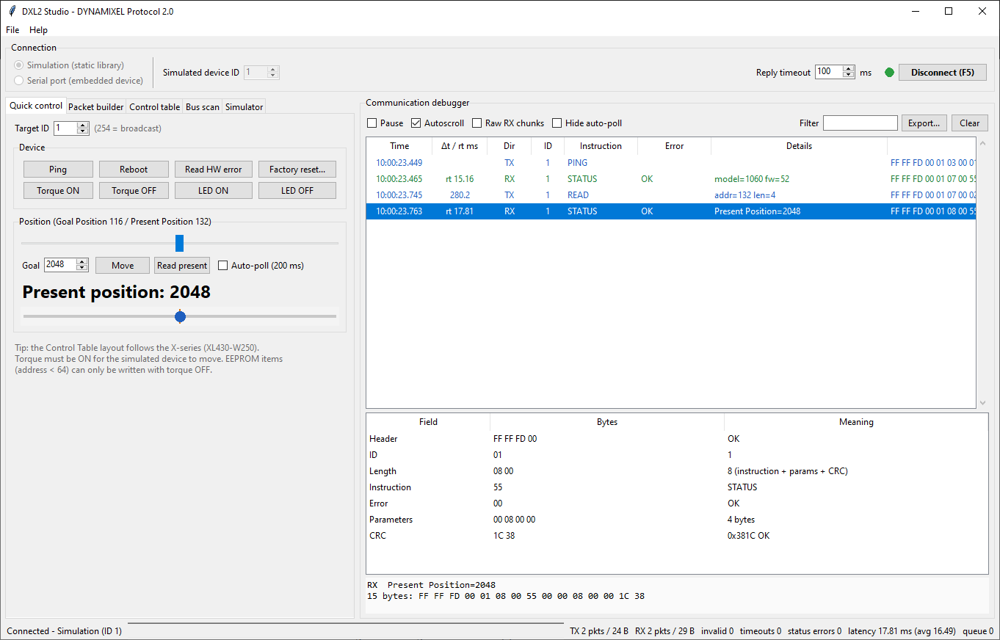
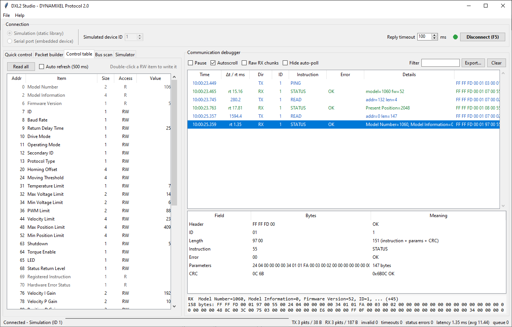
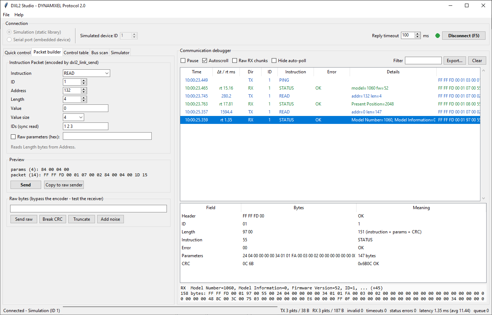
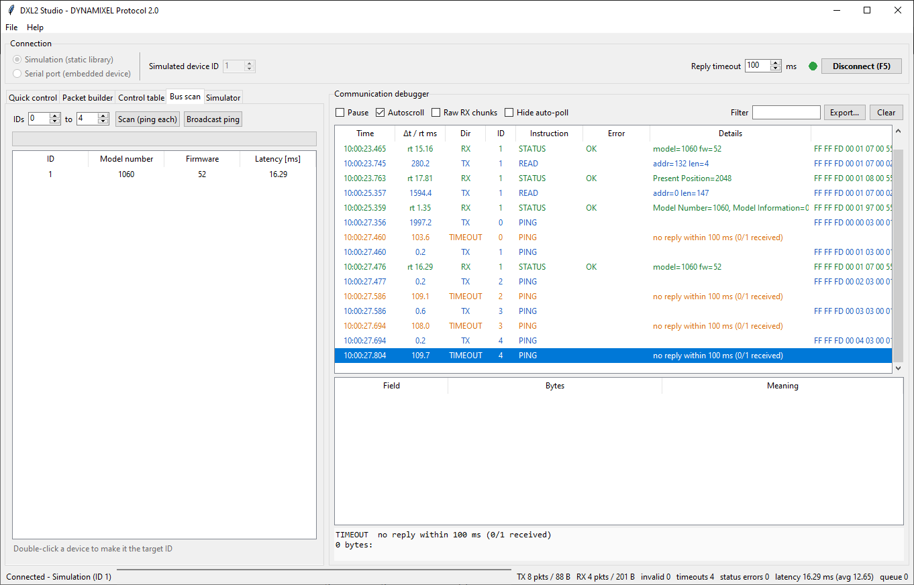
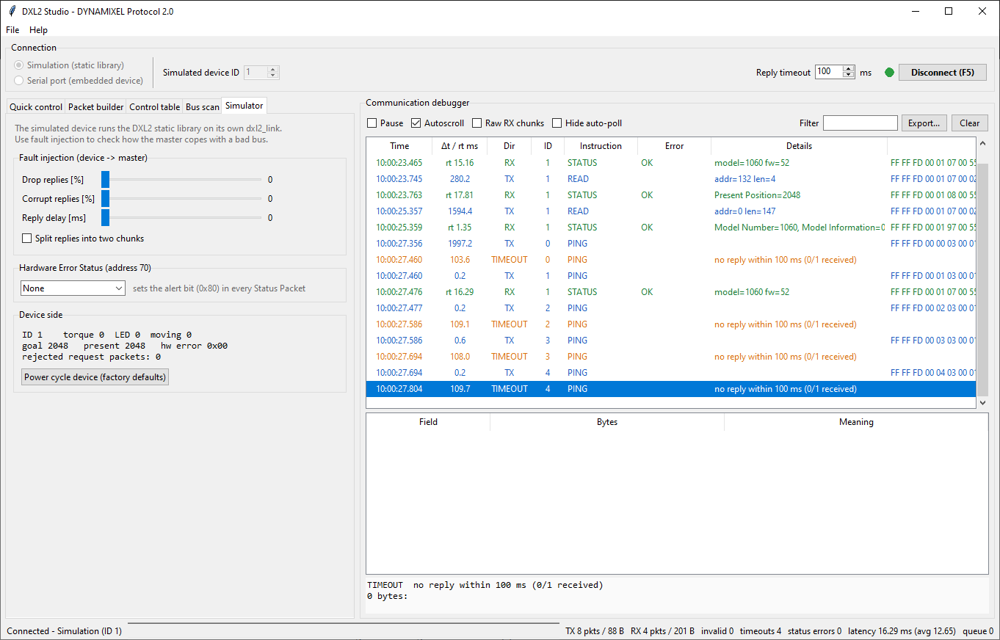

# DXL2 Studio

DXL2 Studio is a desktop application for testing and debugging DYNAMIXEL Protocol 2.0
communication. It is built on the DXL2-C static library itself: every Instruction Packet
it sends is encoded by `dxl2_link_send()` and every byte it receives goes through
`dxl2_link_receive()`. What you see in the tool is exactly what the library does.

{ .screenshot }

## Modes

| Mode | What runs on each side | Hardware |
| --- | --- | --- |
| **Simulation** | The controller and a simulated DYNAMIXEL device (XL430-W250 Control Table) each run the library on their own link | None |
| **Serial port** | The controller runs on the library and talks to a real device over a COM port: a board with DXL2-C, a U2D2 adapter, or a servo | USB-to-serial adapter |

The simulation makes it possible to learn the protocol, try instructions and test error
handling without any hardware. The serial mode turns the same tool into a bus analyzer
for your own firmware.

## Installation and start

DXL2 Studio needs Python 3.8 or newer with Tkinter, CMake 3.20 or newer and a C11
compiler (GCC/MinGW-w64, Clang or MSVC, with the same bitness as Python).

```bash
python -m pip install -r tools/dxl2_gui/requirements.txt   # pyserial, for the serial mode
python tools/dxl2_gui/dxl2_gui.py
```

On the first start the tool offers to build its native bridge, a shared library that
links the static `libdxl2.a`. You can also build it by hand:

```bash
cmake -S tools/dxl2_gui/native -B tools/dxl2_gui/build
cmake --build tools/dxl2_gui/build --config Release
```

Command-line options select the mode and connect at once:

```bash
python tools/dxl2_gui/dxl2_gui.py --mode sim --id 1 --connect
python tools/dxl2_gui/dxl2_gui.py --mode serial --port COM3 --baud 1000000 --connect
```

In VS Code, open the task menu (**Ctrl+Shift+B**), run *Python: Setup venv* once, then
*GUI: Run (Simulation)* or *GUI: Run (Serial port)*.

On Debian and Ubuntu, install the system packages first and add your user to the
`dialout` group to use USB serial adapters without root:

```bash
sudo apt install python3-venv python3-tk cmake build-essential
sudo usermod -aG dialout $USER   # log out and back in afterwards
```

## Window layout

The window has three areas:

- **Connection bar** (top): mode, simulated device ID or serial port and baud rate, reply
  timeout, and the *Connect* button (**F5**).
- **Control tabs** (left): quick control, packet builder, Control Table, bus scan and
  simulator settings.
- **Communication debugger** (right): the packet log, the field-by-field breakdown of the
  selected packet and its raw bytes. The status bar below shows packet and byte counters,
  invalid packets, timeouts, status errors and latency.

### Quick control

Ping, reboot, factory reset, torque and LED on and off, and the Hardware Error Status. A
slider sends the Goal Position; *Auto-poll* reads the Present Position every 200 ms.

### Control Table

{ .screenshot }

*Read all* reads every item with one READ instruction. Items whose value changed since
the last read are highlighted, and *Auto refresh* repeats the read every 500 ms.
Double-click a read-write item to write a new value. The view uses the X-series layout;
for other models use the packet builder.

### Packet builder

{ .screenshot }

Choose an instruction and fill in its fields — or type raw parameters in hex for SYNC and
BULK instructions — and the preview shows the exact packet that `dxl2_encode()` produces,
including byte stuffing and CRC.

The *Raw bytes* sender bypasses the encoder. Its *Break CRC*, *Truncate* and *Add noise*
buttons create invalid input, so you can watch how a receiver — the simulated device or
your own firmware — rejects it and recovers.

### Bus scan

{ .screenshot }

Ping every ID in a range, or send one broadcast PING. The results list the model number,
firmware version and latency of every device. Double-click a result to make it the
target of the other tabs.

### Simulator

{ .screenshot }

In simulation mode this tab injects faults into the replies of the simulated device:
drop a percentage of replies, corrupt one bit, add a delay, or split a reply into two
chunks. You can also set a Hardware Error Status (which sets the alert bit in every
Status Packet), watch the device state and power-cycle the device.

The simulated device implements PING, READ, WRITE, REG_WRITE/ACTION, FACTORY_RESET,
REBOOT, CLEAR, BACKUP, SYNC_READ/WRITE and BULK_READ/WRITE, applies Status Return Level,
the EEPROM lock while torque is on, and the ID, torque and LED range checks. It answers
FAST_SYNC_READ and FAST_BULK_READ with an Instruction Error.

## Communication debugger

Every log entry has a time stamp, the time since the previous entry and, for replies, the
round-trip time (`rt`). Entries are color coded:

| Entry | Meaning |
| --- | --- |
| TX | Instruction Packet sent |
| RX | Status Packet received; interpreted against its request (for example `Present Position=2048`) |
| TIMEOUT | No reply within the reply timeout |
| ERR | Bytes rejected by `dxl2_link_receive()` — on the controller or on the simulated device |
| INFO | Connection and tool messages |

Select an entry to see it field by field — header, ID, Length check, instruction, error,
parameters (with a note when byte stuffing is present) and CRC check. *Raw RX chunks*
shows the bytes exactly as the transport delivered them, before decoding. The log can be
filtered, paused, cleared and exported to CSV or text (**Ctrl+E**).

For serial ports, *Discard echo* removes your own bytes from the receive stream on
single-wire half-duplex buses, and the port field accepts pyserial URLs such as
`socket://192.168.1.10:5000` for serial-over-TCP bridges.

## How the tool uses the library

```text
tools/dxl2_gui/
├── dxl2_gui.py          entry point
├── dxl2gui/
│   ├── app.py           Tkinter user interface
│   ├── session.py       request queue, timeouts, statistics, log entries
│   ├── transport.py     simulation and serial transports, fault injection
│   ├── native.py        ctypes binding and CMake build helper
│   └── decode.py        names, packet breakdown, value formatting
└── native/
    ├── dxl2_host.c/.h   controller side: dxl2_link_send / dxl2_link_receive
    ├── dxl2_sim.c/.h    simulated device on its own dxl2_link
    └── CMakeLists.txt   links the static dxl2 target into dxl2_gui_native
```

The native bridge exports only `dxl2_host_*` and `dxl2_sim_*` functions. Python never
depends on the memory layout of the library structures: it asks the bridge for their
sizes and treats them as opaque. `dxl2_sim.c` is also a useful reference if you write
your own device firmware: it is a complete X-series Control Table on top of the public
API.
