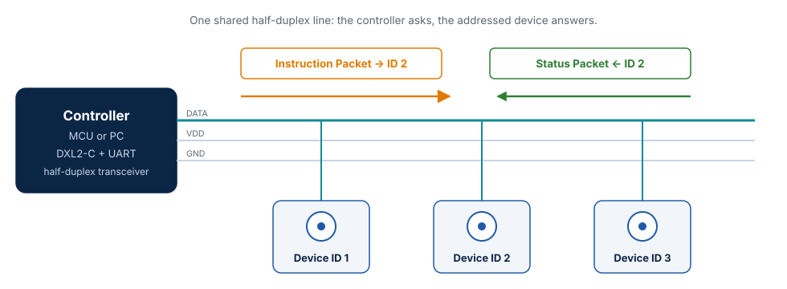
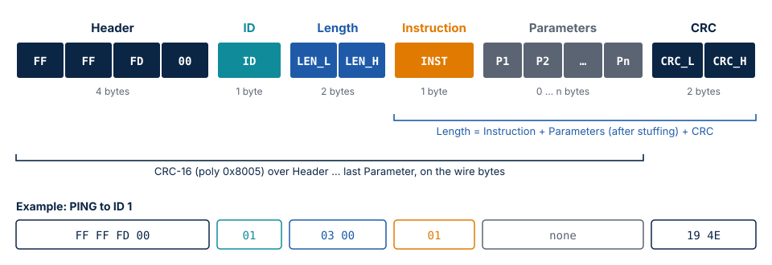
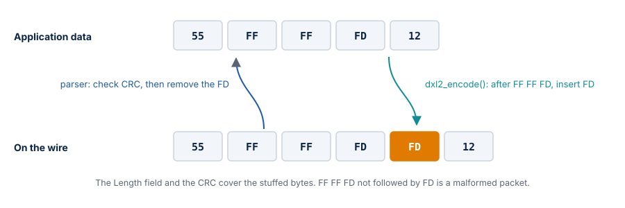

# DYNAMIXEL Protocol 2.0

This chapter describes the Protocol 2.0 wire format and exactly what DXL2-C does with
each part of it. The normative reference is the
[ROBOTIS Protocol 2.0 specification](https://docs.robotis.com/docs/dxl/protocol/protocol2/).

## The bus

DYNAMIXEL devices share one serial line (TTL or RS-485) in a daisy chain. The line is
half duplex: only one node may transmit at a time. Communication is always a
request/response exchange:

1. The **controller** sends an **Instruction Packet** addressed to one ID (0–252) or to
   the broadcast ID 254.
2. The addressed **device** executes it and, unless the instruction was broadcast or its
   Status Return Level says otherwise, answers with a **Status Packet** after its Return
   Delay Time.
3. The controller waits for the reply with a timeout before it sends the next request.

The UART format is 8 data bits, no parity, one stop bit; the bit rate is configured per
device (57600 bit/s by default on most models, up to several Mbit/s).

## Packet

| Field | Offset | Size | Meaning |
| --- | --- | --- | --- |
| Header | 0 | 4 | Always `FF FF FD 00` |
| ID | 4 | 1 | Device ID `0..252`; `0xFE` = broadcast (`DXL2_BROADCAST_ID`) |
| Length | 5 | 2 | Little endian. Counts the instruction, the stuffed parameters and the CRC, so the minimum is 3 |
| Instruction | 7 | 1 | `DXL2_INST_*`; `0x55` marks a Status Packet |
| Parameters | 8 | n | Instruction parameters; for a Status Packet the first byte is the error |
| CRC | 7 + Length − 2 | 2 | Little endian, over all bytes from the header up to the CRC (stuffed) |

A complete packet is therefore `7 + Length` bytes long; the shortest one (no parameters)
is 10 bytes. All multi-byte values inside the parameters — addresses, lengths, register
values — are little endian too: use `dxl2_get_u16/u32` and `dxl2_put_u16/u32`.

In `struct dxl2_packet` the library gives you the ID, the instruction and the
**unstuffed** parameters with their count. The header, Length and CRC are consumed by the
parser.

## CRC-16

Polynomial `0x8005`, initial value `0`, not reflected, no final XOR
(the CRC-16/BUYPASS variant). It is computed over the stuffed packet. The
ROBOTIS PING reference packet `FF FF FD 00 01 03 00 01` has CRC `0x4E19`
(transmitted as `19 4E`). The CRC is computed bit by bit without a lookup table,
which keeps the code small; its execution time depends only on the length.

## Byte stuffing

So that a header never appears inside a packet, the sender inserts an extra
`0xFD` after every `FF FF FD` sequence in the instruction/parameter area, and
the receiver removes it. The Length field counts the stuffed bytes.

The rule applies to the whole area after the Length field — instruction and parameters —
so a sequence that starts in the instruction byte is stuffed too.

`dxl2_encode()` stuffs while it writes. The parser checks the CRC over the
stuffed bytes first, then unstuffs. An `FF FF FD` that is not followed by `FD`
is a malformed packet (`DXL2_PARSE_ERROR`).

## Instructions

| Value | Name | Value | Name |
| --- | --- | --- | --- |
| `0x01` | PING | `0x55` | STATUS (reply) |
| `0x02` | READ | `0x82` | SYNC_READ |
| `0x03` | WRITE | `0x83` | SYNC_WRITE |
| `0x04` | REG_WRITE | `0x8A` | FAST_SYNC_READ |
| `0x05` | ACTION | `0x92` | BULK_READ |
| `0x06` | FACTORY_RESET | `0x93` | BULK_WRITE |
| `0x08` | REBOOT | `0x9A` | FAST_BULK_READ |
| `0x10` | CLEAR | | |
| `0x20` | BACKUP | | |

Parameter layouts of the common instructions:

| Instruction | Parameters |
| --- | --- |
| PING | none; reply data: model number (2), firmware version (1) |
| READ | address (2), length (2); reply data: `length` bytes |
| WRITE / REG_WRITE | address (2), data (n) |
| SYNC_READ | address (2), length (2), ID list |
| SYNC_WRITE | address (2), length (2), then per device: ID (1) + data (`length`) |

The library encodes and decodes every instruction the same way; interpreting
the parameters (the Control Table) is up to the application.

## Status Packet error byte

| Value | `DXL2_ERR_*` | Meaning |
| --- | --- | --- |
| `0x00` | `NONE` | OK |
| `0x01` | `RESULT_FAIL` | Instruction could not be processed |
| `0x02` | `INSTRUCTION` | Undefined instruction, or ACTION without REG_WRITE |
| `0x03` | `CRC` | CRC mismatch |
| `0x04` | `DATA_RANGE` | Value outside the register range |
| `0x05` | `DATA_LENGTH` | Data shorter than the register |
| `0x06` | `DATA_LIMIT` | Value outside the configured limit |
| `0x07` | `ACCESS` | Read-only / write-only / torque-locked register |
| bit 7 | `ALERT_BIT` | Device has a hardware error (Hardware Error Status) |

## Parser behavior

`dxl2_parser_feed()` takes one byte at a time:

1. Bytes before a complete `FF FF FD 00` header are discarded (sliding
   window), so the parser resynchronizes after noise or a lost byte.
2. After 7 bytes it reads Length. A Length below 3 or one that would exceed
   `DXL2_MAX_PACKET_SIZE` (256 bytes on the wire by default, see `inc/dxl2_config.h`) is rejected at once.
3. When the whole packet is in, it checks the CRC, then unstuffs into
   `struct dxl2_packet` and returns `1`.
4. Any error returns `DXL2_PARSE_ERROR` and resets the parser; keep feeding
   bytes, the next packet is found normally.

The bytes of a rejected packet are discarded, including any that follow its
header. If a byte was lost so that the Length field counts into the next
packet, that packet is rejected too and the parser resynchronizes on the one
after it. A controller should therefore treat a missing reply as a timeout
and retry, as the ROBOTIS DynamixelSDK does.

The output packet is not touched while a packet is incomplete or when its CRC
is wrong. After any error its contents are undefined: use it only when
`dxl2_parser_feed()` returns `1`.

## Reference packets (from the specification, used in the tests)

| Packet | Bytes |
| --- | --- |
| PING to ID 1 | `FF FF FD 00 01 03 00 01 19 4E` |
| Status of ID 1 (model 1030, firmware 38) | `FF FF FD 00 01 07 00 55 00 06 04 26 65 5D` |
